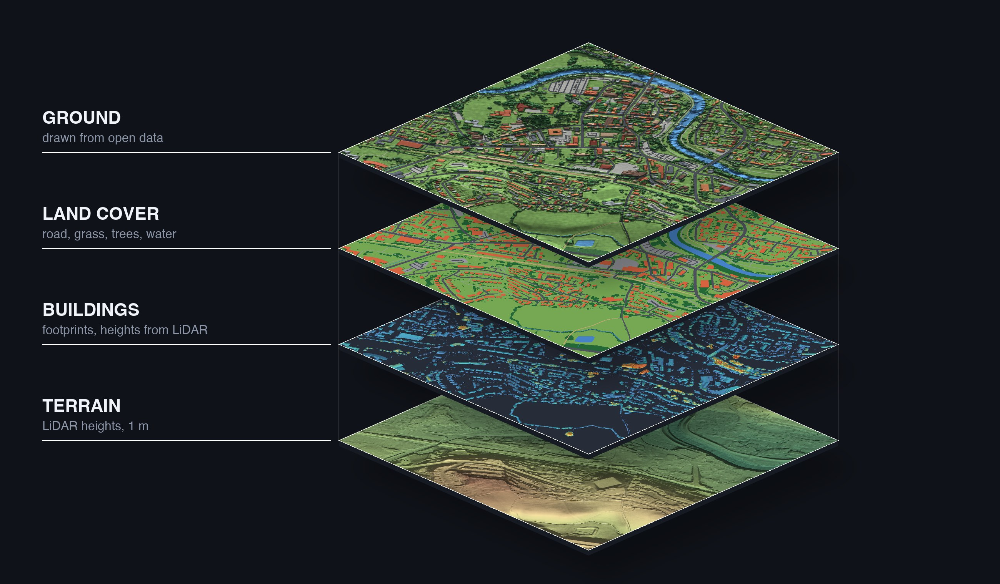
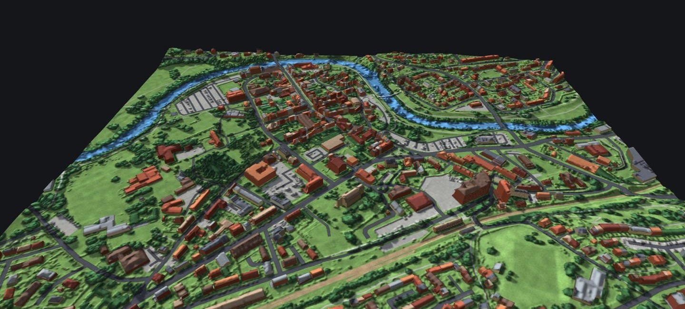
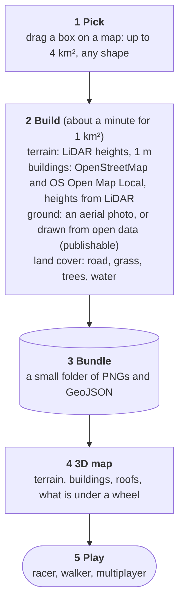

# 3d-model-of-anywhere

Pick a box anywhere in the UK and walk around it in 3D. A Python pipeline turns open map data (terrain heights, building
outlines and heights, and a ground texture) into a small tile bundle, and a three.js client builds the scene from it.

**[Live demo: fly around Newtown, Powys in 3D](https://sergiomarrocoli.github.io/3d-model-of-anywhere/)** (the ground is drawn from open data; picking your own area needs the build service, see "Run it")



*One bundle, in layers (the ground here is the stylised one, drawn from open data): what the build step makes and the 3D map reads.*

[](https://sergiomarrocoli.github.io/3d-model-of-anywhere/)

*The 3D map built from that bundle. [Click to fly around it live](https://sergiomarrocoli.github.io/3d-model-of-anywhere/) (GitHub cannot embed it here).*



Each step in detail, with the choices and fallbacks: [docs/build-process.md](docs/build-process.md).

This repository is only about selecting an area and building a map. The games that use it (a Micro Machines style racer,
a Cannon Fodder style walker, multiplayer) live in `civil-war`, which installs this as a package.

## What is here

- `pipeline/` and `build_area.py`: terrain, buildings, imagery and the tile bundle format (Python; tests in `tests/`).
- `modules/`: `picker` (choose a box on a map), `builder` (an HTTP service that builds it), `map` (reads a bundle, draws it,
  answers ground-height, collision and destruction questions), `credits` (the source and licence lines) and `flow` (the step
  runner). See [modules/README.md](modules/README.md).
- `src/main.js`: the viewer, which picks, builds and flies round an area. `?landcover` (or the L key) tints the ground by land cover.
- Cars are painted out of the imagery, optionally, by [aerial-car-detector](https://github.com/sergiomarrocoli/aerial-car-detector) (a fine-tuned YOLO11n, 5.7 MB): `pipeline/cars.py`. See "Remove cars" below.

## Run it

```
npm install
python3 -m venv .venv && .venv/bin/pip install -r pipeline/requirements.txt
python3 build_area.py --help            # build an area into data/bundles/
npm run dev                             # http://localhost:5173/?area=<id>; ?pick chooses and builds one
python3 modules/builder/server/serve.py # the build service the picker uses
npm run build:demo                      # a static copy of the viewer with the Newtown bundle in public/bundles (what the Pages workflow publishes)
npm test && python3 -m pytest           # JavaScript and Python tests
```

## Land cover

Every build also writes `landcover.png`: one class id per half metre (road, paved, grass, bare, tree, water, building), so a
game can ask what is under a wheel (`map.surfaceAt(x, z)`, see [modules/map/README.md](modules/map/README.md)). It is made
by rules over open data, with no model (`pipeline/landcover.py`):

- roads, paths, rail and rivers from OpenStreetMap lines, widened by the tagged or typical width; water, woods, parks and
  car parks from its areas
- trees from LiDAR canopy height (surface minus terrain) where there is LiDAR, outside buildings
- buildings from the footprints; bridges win over the water and rail beneath, roads win over the trees that overhang them
- anything left is guessed from colour (a green cast is grass, grey is paved, the rest bare)

Known weak spots: the colour guess cannot tell dull grass from tarmac in this imagery, so grass the OSM data does not map
(lawns, verges, gardens) is often called paved. A later phase will replace the guess with a segmentation model (issue #5).
In a 300 m box of Newtown the result is about 29% paved, 18% tree, 16% building, 13% grass, 12% road, 10% bare.

## Remove cars

Parked cars photographed from above end up flat on the road, so the pipeline can paint them out of the imagery:

```
.venv/bin/pip install -U pip && .venv/bin/pip install -r pipeline/requirements-cars.txt   # PyTorch comes with it; needs pip 22 or newer
.venv/bin/python -m pipeline.build_area --bbox 310725 291125 311025 291425 --id newtown-clean --remove-cars
REMOVE_CARS=0 .venv/bin/python modules/builder/server/serve.py                           # the build service removes cars by default once the detector is installed; 0 turns it off
```

A 300 m box takes about 20 s longer and found 212 cars in Newtown. The count is recorded in the bundle's `meta.json` as
`cars_removed`. Without `--remove-cars` nothing changes and PyTorch is not needed.

## Fill missing buildings, register the photo

Two optional steps, both off by default, fix problems in the open data. They need LiDAR (a surface model), so they do nothing
elsewhere and say so in the build log.

```
.venv/bin/python -m pipeline.build_area --bbox 310450 290880 311450 291880 --id newtown --fill-footprints --register
```

- `--fill-footprints`: OpenStreetMap is patchy (whole housing estates can be unmapped while the LiDAR plainly shows them).
  OS Open Map Local buildings are added where OSM has none, leaving out slivers (under 15 m2 or 2 m wide), and kept only
  if the LiDAR then sees something tall there (`pipeline/footprints.py`). They have no tags, so no levels or materials.
- `--register`: the aerial photo is taken at an angle, so a roof appears displaced from its footprint by an offset of the whole
  photo from the OS grid plus its height times a lean. The pipeline measures both and moves everything back
  (`pipeline/register.py`): the offset from OS road centrelines, the lean from how well footprint outlines sit on the
  photo's edges (a sample of 250 buildings), then each footprint is moved as one rigid piece by its own shift and the ground
  a leaned roof had covered is refilled from its surroundings. It writes `imagery_registration` into `meta.json`
  and sets `imagery_lean` to zero, so a viewer that shifts roofs for the lean (see `modules/map`) does not shift them twice.

In a 1 km box of Newtown: 187 buildings added to OSM's 535 (Open Map Local's `SO` square is a 110 MB download, once), a ground
offset of (-0.4 m east, +1.5 m north), a lean of (0.35, -0.15) m per metre of height, and 5.6% of the photo refilled. On a
warm cache the build took 31 s against 14 s without the flags. The lean is fitted per area and assumes one photo capture;
a roof beyond its footprint (or a building in neither data set) is not corrected.

## Choosing the ground: a photograph or drawn from open data

Every build has to say which ground texture it wants (`--imagery` on the command line; a choice on the build screen; `"imagery"` in the build service's request). There is no default.

- **`esri`**: a photograph, Esri World Imagery. It is for development use only, so screenshots and video made with it must not be published, and no open source has crisp aerial photos of Great Britain (the 12.5 and 25 cm national set is for public bodies; Sentinel-2 is open but 10 m per pixel). The photo steps (`--register`, `--remove-cars`) apply only to this one.
- **`stylised`**: the ground drawn from open data, so what you build can be published. Everything in this repository (the README image, the demo) uses it.

```
.venv/bin/python -m pipeline.build_area --bbox 310450 290880 311450 291880 --id newtown-stylised --fill-footprints --imagery stylised
IMAGERY=stylised bin/cars        # in civil-war: a build service that only offers the drawn ground (leave IMAGERY out to offer both and let the picker choose)
```

`pipeline/stylised.py` paints the land cover raster (road, paved, grass, bare, trees, water, buildings) in flat colours, gives every building a roof colour of its own, lights it from the north west with the LiDAR surface (pitched roofs, tree canopies and slopes shade, buildings and trees cast shadows), and adds a grain per surface and a darker line where roads, water and roofs meet the ground. It is crisp at any zoom, matches the footprints exactly (so there is no lean to fix and no cars to remove, and the bundle's `imagery_lean` is zero), takes about 15 s for a 1 km box, and uses only open data (OpenStreetMap, OS Open Map Local, Welsh and English LiDAR) with their attributions. `meta.json` says `imagery_source: "stylised"`; the build service keeps a drawn and a photographic build of one area apart (the drawn one's id ends `-stylised`).

Design notes and data sources are in [PLAN.md](PLAN.md).

## Use it from another project

`npm install git+https://github.com/sergiomarrocoli/3d-model-of-anywhere.git#v0.1.0` (the package is still named `uk-map-3d`), then import `uk-map-3d/map`, `uk-map-3d/flow` and
the other modules listed in `package.json`.

## Data sources and credits

The default, publishable build uses only open data, and a bundle records the credit lines in its `meta.json` and `ATTRIBUTION.txt` (the viewer shows them, `modules/credits`):

- **Terrain and building heights**: LiDAR from the [Environment Agency](https://environment.data.gov.uk/survey) (England) and the [Welsh Government](https://datamap.gov.wales/) (Wales), under the Open Government Licence v3.0. Contains Environment Agency information © Environment Agency and/or database right; Contains Welsh Government LiDAR data © Welsh Government / Llywodraeth Cymru.
- **Buildings, roads, water, land use**: © [OpenStreetMap](https://www.openstreetmap.org/copyright) contributors, under the Open Database Licence (ODbL).
- **Extra buildings, road centrelines, terrain fallback**: Contains OS data © Crown copyright and database right, from [OS Open Map Local and OS Terrain 50](https://www.ordnancesurvey.co.uk/products/os-open-data), under the Open Government Licence v3.0.
- **Geocoding in the picker**: OpenStreetMap's Nominatim, with its basemap tiles.

The photographic option fetches [Esri World Imagery](https://www.arcgis.com/home/item.html?id=10df2279f9684e4a9f6a7f08febac2a9) (Esri, Maxar, Earthstar Geographics) at build time, under Esri's terms of use. Nothing from it is stored in this repository: pick it only for your own development use.

## Licence

The code is under the [MIT licence](LICENSE). The map data is not covered by it: the Newtown bundle in `public/bundles/` (and the images
made from it, such as `docs/layers.jpg`) is derived from the sources above, so it keeps their terms: OpenStreetMap's Open Database
Licence (attribution and share-alike) and the Open Government Licence v3.0, with the credit lines in its `ATTRIBUTION.txt`.
