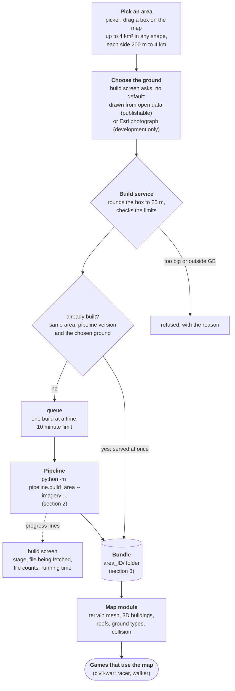
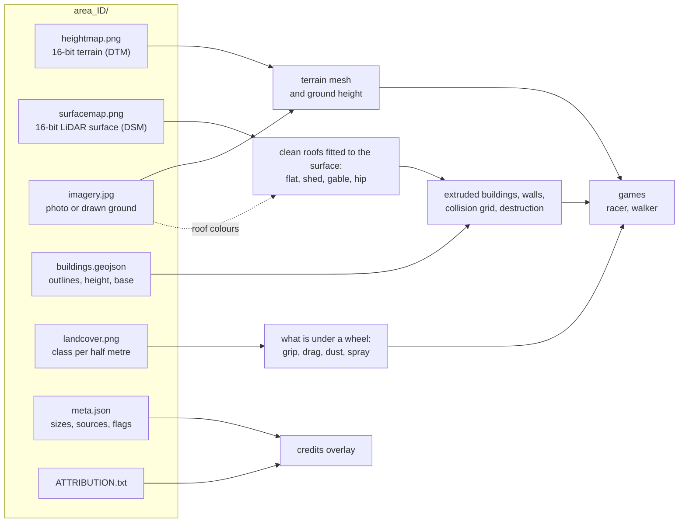

# How an area gets built

From a click in the picker to a 3D map. The diagrams are [Mermaid](https://mermaid.js.org/), which GitHub draws in the page.

## 1. From a click to a map

The build service is `modules/builder/server` (limits, cache, queue, progress); the pick and build steps (and the choice of ground) are the flow in `src/main.js`, run by `modules/flow`. The games at the end belong to civil-war, which installs this as a package; its `bin/cars` starts the service, the game server and the dev server together. A drawn-ground build is its own bundle (its id ends `-stylised`), so a drawn and a photographic build of one area can sit side by side.

## 2. Inside the pipeline

Each step says where its data comes from. Dotted boxes are optional (a flag turns them on); the diamonds are where it chooses.

```mermaid
flowchart TD
    start(["bbox, EPSG:27700"]) --> t

    subgraph T["1 Terrain"]
        t{"where is the LiDAR?"}
        t -- "you supplied tiles" --> dtm_user["--dtm-file"]
        t -- "England" --> ea["Environment Agency LiDAR<br/>DTM and DSM, 1 m"]
        t -- "Wales" --> wg["Welsh Government LiDAR<br/>DTM and DSM, 1 m tiles"]
        t -- "neither" --> t50["OS Terrain 50 only<br/>smooth, no DSM"]
        dtm_user --> fill
        ea --> fill
        wg --> fill
        t50 --> fill
        fill["fill any gaps from<br/>OS Terrain 50"] --> dtm[("dtm.tif and dsm.tif")]
    end

    dtm --> b

    subgraph B["2 Buildings"]
        b["OpenStreetMap footprints<br/>via Overpass"]
        b --> empty{"any found?"}
        empty -- "none" --> oml_all["OS Open Map Local<br/>footprints instead"]
        empty -- "some" --> fillq{"--fill-footprints?"}
        fillq -. "yes" .-> oml_add["add Open Map Local buildings<br/>that OSM does not have<br/>(over 15 m², over 2 m wide)"]
        fillq -- "no" --> clean
        oml_add --> clean
        oml_all --> clean
        clean["clean: flatten to 2D,<br/>drop slivers, simplify 0.3 m"] --> heights
        heights["height = 90th percentile of<br/>DSM minus DTM inside the outline<br/>(else OSM tag, else 6 m)"] --> confirm
        confirm["keep an Open Map Local addition<br/>only if the LiDAR sees it (2 m or more);<br/>with no LiDAR surface, drop them all"] --> basez
        basez["base height = lowest DTM<br/>under the footprint"]
    end

    basez --> g{"--imagery (required:<br/>the user chooses)"}

    subgraph G["3 Ground texture"]
        g -- "esri" --> tiles["Esri World Imagery tiles<br/>0.25 m per pixel<br/>(development use only)"]
        tiles --> reg
        reg{"--register?"}
        reg -. "yes" .-> fit["fit the photo: ground offset from<br/>OS road centrelines, lean from<br/>building outlines on photo edges<br/>then move each roof back"]
        reg -- "no" --> carq
        fit --> carq
        carq{"--remove-cars?"}
        carq -. "yes" .-> cars["paint parked cars out<br/>(YOLO detector, needs the .venv)"]
        carq -- "no" --> photo
        cars --> photo[("imagery.tif<br/>a photograph")]

        g -- "stylised" --> sty0["land cover first, with no photo<br/>(the rules of step 4, but no colour guess:<br/>what map data does not cover is grass)<br/>it goes into the bundle too"]
        sty0 --> sty["draw the ground: flat colours per surface,<br/>a colour for each roof, LiDAR sun light<br/>and shadows, grain, outlines"]
        sty --> drawn[("imagery.tif<br/>drawn, publishable")]
    end

    photo --> lc
    drawn --> bundle
    sty0 -. "landcover.png" .-> bundle

    subgraph L["4 Land cover (a photograph build does it here, a drawn one in step 3)"]
        lc["half-metre class for every cell: a colour guess<br/>from the photo (none when drawn), then painted over by<br/>the sea (flat terrain at or below 1 m), sand on the foreshore,<br/>OSM grass and bare areas, LiDAR trees,<br/>paths, roads, water, building footprints"]
    end

    lc --> bundle

    bundle[("<b>5 Bundle</b><br/>area_ID/ folder<br/>section 3")] --> done(["bundle written<br/>progress: Wrote ..."])
```

Things worth knowing:

- **Caches.** Overpass answers are kept for a week, LiDAR tiles and Open Map Local grid squares (40 to 120 MB, once each) are kept for good, and imagery tiles are not cached at all (a 1 km area is about 500 tiles, a 4 km² one about 2000).
- **Overpass is slow and unreliable.** The pipeline asks overpass-api.de (through `curl`, because macOS's Python cannot make the TLS connection), waits and asks again on 429, 502, 503 and 504, and only then tries the mirrors.
- **Coasts.** OpenStreetMap has no sea polygon and the LiDAR stops at the coast, so the sea is found in the terrain instead: a large plateau at one exact height at or below 1 m (0 m from Terrain 50, −2.3 m in the Welsh LiDAR) is water, low ground that runs into it is sand, and gaps narrower than about 30 m in it (round a pier) are closed.
- **A stylised build** has no photograph to fit and no cars to remove, matches the footprints exactly, and says `imagery_source: "stylised"` and a zero `imagery_lean` in `meta.json`.
- **Without LiDAR** (outside England and Wales) heights come from OSM tags or 6 m, and the footprint filling and photo fitting do nothing and say so.

## 3. What is in a bundle, and who uses it

## 4. The switches

| Switch | Does | Default |
|---|---|---|
| `--fill-footprints` | add Open Map Local buildings where OSM has none, if the LiDAR sees them | off on the command line, on in the build service (`FILL_FOOTPRINTS=0` turns it off) |
| `--register` | (photo builds) fit the photo to the grid and move roofs back onto their outlines | off on the command line, on in the service (`REGISTER_IMAGERY=0`) |
| `--remove-cars` | (photo builds) paint parked cars out of the photo | on in the service when the detector is installed (`REMOVE_CARS=0`) |
| `--imagery esri\|stylised` | the ground texture: the Esri photograph (development use only), or drawn from open data (publishable) | **required, no default.** In the service each request names it (the build screen asks); `IMAGERY=stylised` or `IMAGERY=esri` makes a service offer only that one |
| `--buildings omlocal` | take footprints from Open Map Local only | OSM, falling back to Open Map Local |
| `BUNDLES_DIR` | where the service writes the finished area | this checkout's `data/bundles` (`bin/cars` points it at the game's) |
